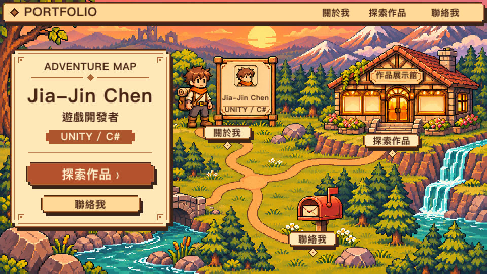

# 視覺設計規格

功能與內容需求另見 [portfolio-spec.md](portfolio-spec.md) 與 [portfolio-content.md](portfolio-content.md)。

第 1 節為現行設計要求，第 2～7 節說明網站實作與待完成項目，第 8 節列出驗收項目。

## 1. 視覺設計要求

### 1.1 參考圖與適用範圍

- 目前以這張完整首頁概念圖作為構圖與美術參考。介面對齊 **480 × 270 px** 的整數格線，上圖為最近鄰放大的 **2×（960 × 540 px）** 版本。[查看 1× 概念圖](design/adventure-homepage-concept-480x270.png)
- 上圖是唯一核定的完整首頁概念圖。製作整景時以[對應的 1× 地景來源](design/adventure-map-concept-480x270.png)對照場景，以上圖對照疊加介面後的完整畫面。先前試稿與現行網站素材均以此圖為驗收基準。
- 概念圖沿用生成後縮製的地景，角色為示意，展示館櫥窗預留給真實作品縮圖。正式場景素材依第 1.6 節在 **480 × 270 px** 原生像素畫布上製作。

### 1.2 整體風格與色彩

- 以潛在雇主、招募人員、客戶與合作夥伴為主要受眾，透過遊戲世界呈現開發者身分。
- 主視覺為暖色夕陽下的冒險地圖：遠景山脈與天空、中景森林與建築、前景道路、石橋、河流及信箱，形成清楚的空間層次。
- 介面使用奶油色／羊皮紙面板、深棕文字與輪廓、陶橘重點色；環境搭配夕陽金、暖棕地形、灰綠植被與藍綠水面。
- 像素語彙延伸至面板階梯邊角、框線、按鈕、指示標記與硬陰影。共用色碼與尺寸整理於 `src/styles/typography.css`，現行色碼見第 3 節。
- 主要資訊必須從場景中清楚浮出，避免背景細節干擾標題、按鈕及文字對比。

### 1.3 首屏構圖

- 頂部保留橫向導覽，品牌在左、導覽在右，採像素框線與淺色底。
- 左側約三分之一預留給羊皮紙介紹面板。面板呈現姓名、開發者定位、Unity／C#，以及作品與聯絡入口。姓名使用頁面主標題，介紹使用已確認的作品集內容。
- 右側場景設有三個可辨識入口：中上方「關於我」、右上方「探索作品」、右下方「聯絡我」，以道路連成同一個世界。
- 首屏下方仍以正常捲動閱讀完整介紹、技能、作品、經歷與聯絡資訊。各區延續相同介面語彙，目前實作見第 5 節。

### 1.4 三個視覺入口

| 入口 | 確定的視覺設定 | 頁內目的地 |
| --- | --- | --- |
| 探索作品 | 作品展示館；暖光櫥窗陳列遊戲海報，入口階梯接上道路 | `#projects` |
| 關於我 | 像素角色立繪＋角色資料面板，搭配姓名、開發定位與真實介紹 | `#about` |
| 聯絡我 | 小徑旁的陶橘紅色信箱，搭配信封與小旗 | `#contact` |

- 角色以圖中的棕色亂髮、橘色圍巾、米白上衣、棕色斜背帶、深色長褲、棕色靴子與附捲毯背包為造型基準；採簡潔臉部與像素角色比例，資料面板頭像須與立繪一致。
- 資料面板不新增虛構等級、能力數值或工作經歷；僅使用 `portfolio-content.md` 與既有資料中可確認的內容。
- 展示館的示意海報於正式製作時替換為真實作品素材；不得將示意畫面當成實際作品。
- 信箱入口先捲動至聯絡區，再由有效的 `mailto` 連結寄信。
- 三個地標各自整合為一張透明背景的像素按鈕圖。角色與資料牌外框、展示館與入口階梯、信箱與小旗分別屬於對應按鈕圖。背景移除這三組地標，補齊原處的地形並保留通往入口的道路。
- 各入口以 HTML 連結包住地標圖與可見名稱。依地標可見範圍重設點擊區，涵蓋地標本體與名稱，避免把大塊透明留白或鄰近道路納入。手機的觸控範圍至少 44 × 44 CSS px，可向外補足，各入口的觸控範圍不得重疊。
- 所有地點入口須有可見名稱，使用者無須猜測物件用途。

### 1.5 道路與場景連續性

- 主路連接角色區、展示館與信箱；石橋兩端須與可行走地面銜接。
- 展示館階梯須連接入口平台與主路，不得出現道路在崖邊中斷或懸空的視覺。
- 信箱保留一條從中央主路蜿蜒而來的進入道路，終止於信箱前。
- 信箱支路須連續，避免孤立圓環、草地斷口或重複岔路。
- 場景物件落地、遮擋、道路寬度與透視須一致，入口不得被樹木或裝飾遮住。

### 1.6 畫布與像素製作要求

- **480 × 270 px（16:9）是原生作畫尺寸。** 首屏地圖的背景、地形、植被、道路、角色與資料牌、展示館與階梯、信箱與小旗，以及圖內裝飾，須在同一張整景母稿的共用網格上作畫。原稿每格為 1 × 1 px，筆觸與輪廓對齊整數像素，不使用反鋸齒。
- 整景須使用一致的像素尺度。比較各區的描邊厚度、陰影邊緣和細節大小，避免混入來自其他解析度的像素尺度。生成參考稿如有尺度差異，須在原生網格上重繪或逐區修整。高解析度圖縮至 480 × 270，或將 240 × 135 圖以固定 2 × 2 像素塊放大，均不符合原生作畫要求。
- 拆圖前，將疊有介面的新整景與第 1.1 節的核定稿以 **960 × 540 px** 並排比對。檢查配色、光影、細節密度、地標輪廓與比例、面板及標籤位置。記錄可見差異，經使用者確認後才拆分圖層並接入網站。
- 依地標可見範圍以原尺寸裁出透明圖，並在背景補齊地形。記錄原生尺寸與整數座標，以 1× 原位合成，確認角色腳底、展示館階梯底端與信箱柱腳接到地面及道路。
- **審稿須提供 1×（480 × 270）和 2×（960 × 540）。** 在 1× 檢查地景與地標的像素尺度及接縫，在 2× 確認最近鄰放大後，每個原稿像素完整對應到同色的 2 × 2 方格，邊緣清楚。其他放大稿也採最近鄰與整數倍等比縮放，例如 3×（1440 × 810）。
- 網站背景與地標使用同一比例等比縮放，沿用共用座標系，像素圖以 `image-rendering: pixelated` 顯示。響應式版面可裁切共同場景外框，須確認像素邊緣清楚，三個地標、名稱與互動範圍完整可用。
- 圖中的文字與按鈕於網站實作時應使用可存取的 HTML 內容及控制項；避免將整張圖當作唯一介面，造成文字無法選取、按鈕無法聚焦或放大後難以閱讀。

### 1.7 字體、響應式與操作

- 標題及短標籤採適合的像素字體；中文字形、授權與載入方式尚待確認。較長的介紹、職責與作品內文優先確保可讀性。
- 桌面以本圖的 16:9 構圖為基準；平板及手機需另行安排面板、場景裁切及入口，不得將整張桌面圖縮至文字難以辨識。
- 手機可將文字面板與場景分段排列，三個入口仍須完整可操作；目前實作採介紹與地圖上下排列，驗收項目見第 8 節。
- 視覺入口與導覽須支援鍵盤、觸控及可見焦點，不依賴 滑鼠懸停才能發現內容；頁內連結保留平滑捲動與減少動態偏好支援。
- 技能、作品影片、職責展開、Email 等既有功能繼續依 `portfolio-spec.md` 驗收，不因場景化而移除。

## 2. 實作檔案與素材

| 檔案 | 責任 |
| --- | --- |
| `src/components/AdventureHero.jsx` | 首屏介紹、分層場景、展示館櫥窗與三個地點導覽 |
| `public/images/adventure/` | 480 × 270 原生重繪背景及三張透明地標圖 |
| `public/fonts/VT323-Regular.ttf` | 本機載入的英數像素字體 |
| `public/fonts/VT323-OFL.txt` | 字體的 SIL Open Font License 授權 |
| `src/styles/typography.css` | 字體、字級、色彩、內容寬度、影片寬度及間距變數 |
| `src/app/globals.css` | 字體載入、全域樣式、焦點、選取與減少動態偏好 |
| `src/components/PortfolioApp.css` | 場景定位、面板、元件及響應式樣式 |
| `src/components/PortfolioApp.jsx` | 頁面結構與介紹文案 |
| `src/components/ProjectCard.jsx` | 作品影片切換、職責展開及外部連結 |
| `src/components/Navbar.jsx` | 導覽與手機選單 |
| `src/lib/video.js` | 地圖櫥窗及作品播放器共用的 YouTube ID 解析 |
| `src/data/portfolio.js` | 個人資料、導覽項目及專案資料 |

背景與三個地標共用 480 × 270 原生像素格。整景預覽與各圖層座標見[素材製作紀錄](design/adventure-map-production.md)。

## 3. 實作色彩與字體

| CSS 變數 | 色碼 | 用途 |
| --- | --- | --- |
| `--color-background` | `#fbf3e1` | 暖米色內容區 |
| `--color-surface` | `#fff8e9` | 卡片、影片控制項 |
| `--color-parchment` | `#ffe6b3` | 羊皮紙面板 |
| `--color-ink` | `#442917` | 深棕主文字 |
| `--color-muted` | `#78604a` | 次要文字 |
| `--color-accent` | `#a64222` | 按鈕、標記、連結與焦點 |
| `--color-line` | `#d3b58a` | 分隔線、次要框線 |
| `--color-frame` | `#6b3b20` | 主面板及按鈕深色外框 |
| `--color-gold` | `#d89545` | 技能標記 |
| `--color-shadow` | `#b37a45` | 暖棕硬陰影 |

- 英數標題、眉標及技術標籤使用本機 VT323；無第三方字體執行時請求。
- 中文及較長內容使用系統字體堆疊，基本字級 16px、行高 1.8，優先維持可讀性；中文像素字體尚未選定。
- 場景保留圖像細節，以 `image-rendering: pixelated` 顯示；實際遊戲縮圖維持一般圖像呈現，不強制轉成像素畫。
- 面板採深棕框線、內側淺色線、角落裝飾與硬陰影。

## 4. 首屏與響應式實作

- 桌面首屏採 16:9，場景最大寬度 1680px；導覽在首屏外側頂部正常捲動。
- 左側 HTML 羊皮紙面板寬度為場景 33%，呈現姓名、開發者定位、Unity／C#、介紹及作品與聯絡入口。
- 角色資料卡文字、展示館名稱、地點標籤及所有操作按鈕皆為 HTML；圖片提供描述場景的替代文字。
- 三個地點的透明圖與可見標籤共用 HTML 連結，直接前往 `#about`、`#projects`、`#contact`，標籤具有 滑鼠懸停與鍵盤聚焦的視覺回饋；不需開啟新頁面。
- 展示館三個窗位疊加前三個真實作品的 YouTube 縮圖。生成圖的櫥窗預留空位。
- 信箱入口使用一條主路連接中央路口；保留石橋兩端及展示館階梯的銜接，無多餘信箱環路。

| 斷點 | 實作行為 |
| --- | --- |
| 大於 1100px | 完整首屏介紹；次要專案三欄 |
| 小於等於 1100px | 隱藏首屏補充主張、縮小面板內距；次要專案兩欄 |
| 701～850px | 微調首屏字級、間距及地點標籤，避免面板擠壓 |
| 小於等於 700px | 手機導覽收合；介紹面板與地圖上下排列；地圖保留右側三個地點；下方區塊及專案改單欄 |

手機地圖顯示右側場景，透過等比例圖像及對應的百分比座標維持物件位置。地點控制項至少 44px 高。視窗達 1360px 時，信箱標籤置於下方，其餘尺寸放在右側。主要內容最大寬度 1160px，左右內距桌面 2rem、手機 1.25rem。

## 5. 下方內容區

- 關於我：左側區塊標題，右側羊皮紙介紹面板；手機垂直排列。
- 技能：保留 Unity、C#、Git、Codex，使用像素英數字體、方形標記與硬陰影標籤。
- 作品展示館：第一個專案仍為 Sandwich Tycoon，桌面左影片、右內容；其他專案依既有資料順序排列。
- 所有作品保留簡介、技術、職責、上架備註與連結，不新增或捏造個人經歷。
- 工作經驗：沿用待補充提示，提供返回作品職責的入口。
- 聯絡區：信件風格面板與信封裝飾，保留真實 Email 與 `mailto`。
- 頁尾：姓名與「回到地圖」連結。

## 6. 影片與可存取操作

- 作品影片維持 16:9，初始顯示 YouTube 縮圖及具名播放按鈕；縮圖錯誤時改用 `hqdefault.jpg`。
- 播放時在原位置掛載 iframe 並要求自動播放；關閉後卸載 iframe、停止播放並恢復縮圖。實際播放受 YouTube 與瀏覽器限制。
- 職責使用原生 `details`／`summary`，外部連結以新分頁開啟。
- 手機導覽提供 `aria-controls`、`aria-expanded`，點擊連結後收合。
- 提供跳至主要內容連結、可見焦點、語意化標題及區塊；地點入口支援鍵盤與觸控。
- 錨點平滑捲動；`prefers-reduced-motion: reduce` 時取消平滑捲動與轉場。

## 7. 已知限制

- 中文像素字體及完整無障礙稽核仍待後續處理。
- YouTube 縮圖、影片與商店目的地依賴外部服務；工作經歷仍待提供真實資料。

## 8. 驗收項目

### 視覺驗收

- 拆圖前依第 1.6 節提交整景對照及差異紀錄。接入後以同尺寸桌面截圖再次比對核定稿，另檢查手機裁切。視覺驗收通過後再清理被取代的素材。

### 素材與功能驗收

- 依第 1.6 節檢查 1× 整景母稿、最近鄰 2× 放大稿及地標原位合成。
- 檢查桌面、平板與手機版面，確認沒有水平溢位，三個地標及名稱完整可見。以鍵盤和觸控確認入口可操作、焦點清楚，且觸控範圍符合第 1.4 節。
- 確認主要導覽、作品播放與關閉、職責展開及聯絡連結可正常使用。執行 `npm run lint` 與 `npm run build`。
