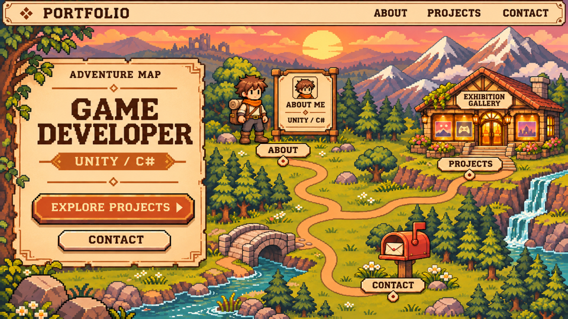

# 視覺設計規格

功能與內容需求另見 [portfolio-spec.md](portfolio-spec.md) 與 [portfolio-content.md](portfolio-content.md)。

**2026-11-03 更新：以暖色像素冒險地圖概念圖作為後續視覺改版基準。** 第 1 節記錄本次確認的設計目標；第 2～7 節記錄現有程式實作與限制，第 8 節記錄本次驗證，第 9 節為歷史遷移驗證。新舊外觀有差異時，以第 1 節的目標為準，現有功能需求仍須保留。2026-11-04 已開始實作並套用本圖方向，實作細節與驗收見下文。

## 1. 已確認的視覺設計目標

### 1.1 參考圖與適用範圍

- 參考檔案：[portfolio-map-960x540.png](design/portfolio-map-960x540.png)，實際圖片尺寸為 **960 × 540 px（16:9）**，同時作為場景的邏輯畫布尺寸。
- 此圖為目前選定的首頁構圖與美術方向；其中的角色、海報、英文文案是示意，並非真實個人形象或作品資料。
- 早期曾比較像素工作室、冒險地圖與遊戲選單；本版採用使用者指定的地圖構圖，保留遊戲開場與選單的視覺語彙，並以本圖為準。
- 本圖取代原先「簡潔專業、少量像素點綴」的主視覺方向。目標是一眼能辨識的像素遊戲風格，同時保有作品集的閱讀與導覽效率。

### 1.2 整體風格與色彩

- 以潛在雇主、招募人員、客戶與合作夥伴為主要受眾，透過遊戲世界呈現開發者身分。
- 主視覺為暖色夕陽下的冒險地圖：遠景山脈與天空、中景森林與建築、前景道路、石橋、河流及信箱，形成清楚的空間層次。
- 介面使用奶油色／羊皮紙面板、深棕文字與輪廓、陶橘重點色；環境搭配夕陽金、暖棕地形、灰綠植被與藍綠水面。
- 像素語彙延伸至面板階梯邊角、框線、按鈕、指示標記與硬陰影。共用色碼與尺寸整理於 `src/styles/typography.css`，現行色碼見第 3 節。
- 主要資訊必須從場景中清楚浮出，避免背景細節干擾標題、按鈕及文字對比。

### 1.3 首屏構圖

- 頂部保留橫向導覽，品牌在左、導覽在右，採像素框線與淺色底。
- 左側大型羊皮紙面板呈現開發者定位、Unity／C# 與主要行動入口。保留圖中的左側面板配置，不改為置中大型選單遮住地圖。
- 面板眉標為 `ADVENTURE MAP`，移除概念編號 `02 /`。
- 概念圖中的 `GAME DEVELOPER`、`EXPLORE PROJECTS`、`CONTACT` 為視覺參考；正式姓名、介紹與介面文案須由既有內容及資料來源決定，保留清楚的姓名 H1。
- 右側場景設有三個可辨識入口：中上方「關於我」、右上方「探索作品」、右下方「聯絡我」，以道路連成同一個世界。
- 首屏下方仍以正常捲動閱讀完整介紹、技能、作品、經歷與聯絡資訊。各區延續相同介面語彙，目前實作見第 5 節。

### 1.4 三個視覺入口

| 入口 | 確定的視覺設定 | 頁內目的地 |
| --- | --- | --- |
| 探索作品 | 作品展示館；暖光櫥窗陳列遊戲海報，入口階梯接上道路 | `#projects` |
| 關於我 | 像素角色立繪＋角色資料面板，搭配姓名、開發定位與真實介紹 | `#about` |
| 聯絡我 | 小徑旁的陶橘紅色信箱，搭配信封與小旗 | `#contact` |

- 角色以圖中的棕色亂髮、橘色圍巾、米白上衣、棕色斜背帶、深色長褲、棕色靴子與附捲毯背包為造型基準；採簡潔臉部與像素角色比例，資料面板頭像須與立繪一致。
- 資料面板不新增虛構等級、能力數值或工作經歷；僅使用 `portfolio-content.md` 與既有資料中可確認的內容。
- 展示館的示意海報於正式製作時替換為真實作品素材；不得將示意畫面當成實際作品。
- 信箱入口先捲動至聯絡區，再由有效的 `mailto` 連結寄信。
- 所有地點入口須有可見名稱，使用者無須猜測物件用途。展示館亮燈、角色反應、信封或小旗動態可作為後續互動提案，尚未定稿或實作。

### 1.5 道路與場景連續性

- 主路連接角色區、展示館與信箱；石橋兩端須與可行走地面銜接。
- 展示館階梯須連接入口平台與主路，不得出現道路在崖邊中斷或懸空的視覺。
- 信箱保留一條從中央主路蜿蜒而來的進入道路，終止於信箱前。
- 移除信箱標示左側多餘的短支路與環形道路，不保留孤立圓環、草地斷口或重複岔路。
- 場景物件落地、遮擋、道路寬度與透視須一致，入口不得被樹木或裝飾遮住。

### 1.6 畫布與像素製作要求

- 場景以 **960 × 540 邏輯單位**為設計基準；這是美術畫布尺寸，並非將整個網頁或文字區固定為此尺寸。
- 正式像素素材須在共用網格上製作，統一角色、建築、植物、地形及介面裝飾的像素尺度、輪廓厚度與細節密度。
- 本次參考圖由 AI 生成後縮放輸出，雖已確認檔案為 960 × 540 px，**尚未達成嚴格一致的原生像素網格**，部分細節仍有混合尺度及縮放柔化。先用於構圖與風格參考，不作為像素製作已驗收的證明。
- 後續若要求嚴格統一像素密度，須在原生網格重繪或逐區修整，於 100% 與整數倍放大檢查；單純改尺寸、銳化或設定 `image-rendering: pixelated` 無法修復素材內部的尺度差異。
- 像素美術匯出／放大採最近鄰與整數倍縮放，避免平滑插值；不以拉伸改變角色、建築與場景比例。
- 圖中的文字與按鈕於網站實作時應使用可存取的 HTML 內容及控制項；避免將整張圖當作唯一介面，造成文字無法選取、按鈕無法聚焦或放大後難以閱讀。

### 1.7 字體、響應式與操作

- 標題及短標籤採適合的像素字體；中文字形、授權與載入方式尚待確認。較長的介紹、職責與作品內文優先確保可讀性。
- 桌面以本圖的 16:9 構圖為基準；平板及手機需另行安排面板、場景裁切及入口，不得將整張桌面圖縮至文字難以辨識。
- 手機可將文字面板與場景分段排列，三個入口仍須完整可操作；目前實作採介紹與地圖上下排列，驗證見第 8 節。
- 視覺入口與導覽須支援鍵盤、觸控及可見焦點，不依賴 hover 才能發現內容；頁內連結保留平滑捲動與減少動態偏好支援。
- 技能、作品影片、職責展開、Email 等既有功能繼續依 `portfolio-spec.md` 驗收，不因場景化而移除。

## 2. 實作檔案與素材

2026-11-04 已將第 1 節的方向套用於首頁及下方內容區；原始概念圖保留作為構圖參考。

| 檔案 | 責任 |
| --- | --- |
| `src/components/AdventureHero.jsx` | 首屏介紹、場景圖、展示館櫥窗與三個地點導覽 |
| `public/images/adventure-map.png` | 從概念圖整理的無文字場景素材；含角色、展示館、信箱及連通道路 |
| `public/fonts/VT323-Regular.ttf` | 本機載入的英數像素字體 |
| `public/fonts/VT323-OFL.txt` | 字體的 SIL Open Font License 授權 |
| `src/styles/typography.css` | 字體、字級、色彩、內容寬度、影片寬度及間距變數 |
| `src/app/globals.css` | 字體載入、全域樣式、焦點、選取與減少動態偏好 |
| `src/components/PortfolioApp.css` | 場景定位、面板、元件及響應式樣式 |
| `src/components/PortfolioApp.jsx` | 頁面結構與介紹文案 |
| `src/components/ProjectCard.jsx` | 作品影片切換、職責展開及外部連結 |
| `src/components/Navbar.jsx` | 導覽與手機選單 |
| `src/lib/video.js` | 地圖櫥窗及作品播放器共用的 YouTube ID 解析 |
| `src/data/portfolio.js` | 個人資料、導覽項目及專案資料 |

場景使用內建 imagegen 編輯工具，以概念圖為參考移除烘焙文字／介面，並補回展示館道路；提示詞記錄於 [素材製作紀錄](design/adventure-map-production.md)。生成圖保留原始輸出解析度，以 960 × 540 的邏輯座標及百分比定位，不宣稱此素材已是嚴格原生像素製作。

Next.js 入口為 `src/app/page.jsx` 與 `src/app/layout.jsx`；全域樣式由 layout 匯入。首屏與靜態內容使用 Server Components，手機選單與影片播放器使用 Client Components。

## 3. 實作色彩與字體

| CSS 變數 | 色碼 | 用途 |
| --- | --- | --- |
| `--color-background` | `#fbf3e1` | 暖米色內容區 |
| `--color-surface` | `#fff8e9` | 卡片、影片控制項 |
| `--color-parchment` | `#ffe6b3` | 羊皮紙面板 |
| `--color-ink` | `#442917` | 深棕主文字 |
| `--color-muted` | `#78604a` | 次要文字 |
| `--color-accent` | `#a64222` | 按鈕、標記、連結與焦點 |
| `--color-line` | `#d3b58a` | 分隔線、次要框線 |
| `--color-frame` | `#6b3b20` | 主面板及按鈕深色外框 |
| `--color-gold` | `#d89545` | 技能標記 |
| `--color-shadow` | `#b37a45` | 暖棕硬陰影 |

- 英數標題、眉標及技術標籤使用本機 VT323；無第三方字體執行時請求。
- 中文及較長內容使用系統字體堆疊，基本字級 16px、行高 1.8，優先維持可讀性；中文像素字體尚未選定。
- 場景保留圖像細節，以 `image-rendering: pixelated` 顯示；實際遊戲縮圖維持一般圖像呈現，不強制轉成像素畫。
- 面板採深棕框線、內側淺色線、角落裝飾與硬陰影；未新增深色主題。

## 4. 首屏與響應式實作

- 桌面首屏採 16:9，場景最大寬度 1680px；導覽在首屏外側頂部正常捲動。
- 左側 HTML 羊皮紙面板寬度為場景 33%，包含 `ADVENTURE MAP`、`GAME DEVELOPER`、真實姓名 H1、Unity／C#、既有主張與作品／聯絡入口。
- 角色資料卡文字、展示館名稱、地點標籤及所有操作按鈕皆為 HTML；圖片提供場景描述的 alt。
- 三個地點標籤直接連結 `#about`、`#projects`、`#contact`，具有 hover／focus 選取游標及背景變化；不需開啟新頁面。
- 展示館三個窗位疊加前三個真實作品的 YouTube 縮圖。場景原有海報為裝飾底圖，不作為實際作品資料。
- 信箱入口使用一條主路連接中央路口；保留石橋兩端及展示館階梯的銜接，無多餘信箱環路。

| 斷點 | 實作行為 |
| --- | --- |
| 大於 1100px | 完整首屏介紹；次要專案三欄 |
| 小於等於 1100px | 隱藏首屏補充主張、縮小面板內距；次要專案兩欄 |
| 701～850px | 微調首屏字級、間距及地點標籤，避免面板擠壓 |
| 小於等於 700px | 手機導覽收合；介紹面板與地圖上下排列；地圖保留右側三個地點；下方區塊及專案改單欄 |

手機地圖顯示右側場景，透過等比例圖像及對應的百分比座標維持物件位置；地點控制項至少 44px 高。信箱標籤以可用高度限制位置，避免在窄螢幕底部被裁掉。主要內容最大寬度 1160px，左右內距桌面 2rem、手機 1.25rem。

## 5. 下方內容區

- 關於我：左側區塊標題，右側羊皮紙介紹面板；手機垂直排列。
- 技能：保留 Unity、C#、Git、Codex，使用像素英數字體、方形標記與硬陰影標籤。
- 作品展示館：第一個專案仍為 Sandwich Tycoon，桌面左影片、右內容；其他專案依既有資料順序排列。
- 所有作品保留簡介、技術、職責、上架備註與連結，不新增或捏造個人經歷。
- 工作經驗：沿用待補充提示，提供返回作品職責的入口。
- 聯絡區：信件風格面板與信封裝飾，保留真實 Email 與 `mailto`。
- 頁尾：姓名與「回到地圖」連結。

## 6. 影片與可存取操作

- 作品影片維持 16:9，初始顯示 YouTube 縮圖及具名播放按鈕；縮圖錯誤時改用 `hqdefault.jpg`。
- 播放時在原位置掛載 iframe 並要求自動播放；關閉後卸載 iframe、停止播放並恢復縮圖。實際播放受 YouTube 與瀏覽器限制。
- 職責使用原生 `details`／`summary`，外部連結以新分頁開啟。
- 手機導覽提供 `aria-controls`、`aria-expanded`，點擊連結後收合。
- 提供跳至主要內容連結、可見焦點、語意化標題及區塊；地點入口支援鍵盤與觸控。
- 錨點平滑捲動；`prefers-reduced-motion: reduce` 時取消平滑捲動與轉場。

## 7. 已知限制

- 圖片是 AI 生成的場景素材，尚未完成嚴格像素網格重繪；角色與環境的細節密度不宣稱完全一致。
- 原生素材製作、中文像素字體及完整無障礙稽核仍待後續處理。
- YouTube 縮圖、影片與商店目的地依賴外部服務；工作經歷仍待提供真實資料。
- 新增素材與元件需要納入 Git，因此補上 `.gitignore` 的 `src`、`public` 等專案檔案例外。
- `npm run lint` 改用既有依賴 Oxlint；移除會接續執行無關 npm 範本檢查的 `postlint`，不再依賴未安裝的 ESLint。

## 8. 本次驗證（2026-11-04）

- `npm run lint` 與 `npm run build` 成功，首頁仍為靜態預先產生。
- 正式環境本機伺服器回傳 HTTP 200，瀏覽器能載入場景與本機字體。
- 桌面 1440px、平板 768px、手機 390px 視覺抽查；320、390、700、701、768、960、1240、1440px 均無水平溢位，介紹面板與三個地點標籤完整可見。
- 三個地圖入口可用 Enter 前往 `#about`、`#projects`、`#contact`；本次瀏覽器日誌未捕捉到 console warning 或 error。
- 手機導覽可用 Enter 開啟，選取「精選專案」後捲動並收合。
- Sandwich Tycoon 播放器可開啟，關閉後 iframe 數量回到零，播放按鈕恢復。
- 主打作品職責可用 Enter 展開。
- 此紀錄不代表全部第三方影片、商店目的地或完整無障礙已驗收；後續程式改動須重新執行相應檢查。

## 9. 歷史紀錄：Next.js 遷移驗證

以下為先前遷移的紀錄，非本次重新執行的測試結果，也不代表新主視覺已驗收；實際依賴版本與指令以目前專案檔案為準。

- 使用 Next.js 16.4.3、React 19.3.1、Oxlint 1.90.0；依賴版本記錄於 `pnpm-lock.yaml`。
- lint 與 production build 成功；建置確認 `/` 為靜態預先產生頁面。
- 正式環境伺服器啟動成功，瀏覽器能載入首頁與 metadata 標題。
- 1280px 桌面及 390px 手機版面已視覺抽查；1240、960、768、700、390、320px 寬度沒有水平溢位。
- 驗證四個專案存在，所有頁內錨點都有對應目標。
- 驗證手機導覽可用 Enter 開啟，點擊「精選專案」後前往 `#projects` 並收合選單。
- 驗證 Sandwich Tycoon 影片播放器開啟；關閉後 iframe 數量回到零並恢復播放按鈕。
- 驗證主打作品職責可使用 Enter 展開。
- 本次瀏覽器檢查沒有捕捉到 console warning 或 error。
- 未逐一驗證全部影片播放、商店目的地與完整無障礙稽核；外部服務狀態及自動播放仍受第三方與瀏覽器限制。
